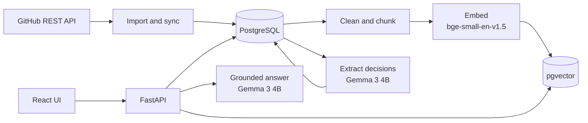

# Open-Source Decision Intelligence and Knowledge Recovery

Projects make many technical decisions in issue and pull request threads, and few of them end up in a design doc. When the people who made them leave, the reasons are hard to find.

This project imports a public GitHub repository, finds the decisions in its discussions, and answers questions like "why was X rejected?" with links to the exact comments that support the answer.

## What it does

- **Import** issues, pull requests, comments and code reviews from any public GitHub repository. Later syncs only fetch what changed. If the GitHub rate limit runs out, the import pauses and continues on the next sync.
- **Extract decisions** with a local LLM (Gemma 3 4B through Ollama). Each decision has the decision itself, the rationale, rejected alternatives with the reason they were rejected, and evidence quotes.
- **Ask questions** in plain language. The answer is built only from retrieved discussion text and cites its sources.
- **Browse** decisions per repository in a web UI, with every quote linked back to GitHub and the files and lines each decision touched.
- **Review pull requests** with a GitHub Action that comments on new PRs with past decisions about the files they change. See [docs/pr-bot.md](docs/pr-bot.md).

## How it avoids made-up answers

LLMs invent things, so the pipeline checks the model instead of trusting it:

- Every evidence quote must appear word for word in the message it cites, or it is dropped. A decision with no real quote is not saved.
- A decision found only in the opening post is kept as `proposed`, never `accepted`, since nobody else has agreed to it yet.
- Model output must match a JSON schema and is validated again with Pydantic. Bad output is retried once.
- Discussion text is passed to the model as data, with an instruction to ignore any commands inside it.
- Questions with no evidence above a similarity threshold get an "insufficient evidence" reply without calling the model. Answer citations that point to sources the model was not given are removed.

## Architecture



The backend is one FastAPI app split into modules (ingestion, processing, embeddings, extraction, retrieval, generation). PostgreSQL with pgvector holds both the data and the vectors, so there is no separate vector database. Both models run locally and no data leaves the machine.

More detail: [architecture](docs/architecture.md), [AI pipeline](docs/ai-pipeline.md), [API](docs/api-design.md), [database schema](docs/database-schema.md).

## Technology

- **Backend:** Python 3.11+, FastAPI, Pydantic, SQLAlchemy, Alembic
- **Storage:** PostgreSQL with pgvector
- **AI:** Gemma 3 4B through Ollama, `BAAI/bge-small-en-v1.5` embeddings
- **Frontend:** React, TypeScript, Vite, Tailwind CSS v4, shadcn/ui
- **Tests and CI:** Pytest against a real PostgreSQL with pgvector, Vitest, React Testing Library, GitHub Actions

## Getting started

### Prerequisites

- Python 3.11 or newer
- Node.js 22 or newer
- PostgreSQL with the pgvector extension
- [Ollama](https://ollama.com) with the model pulled: `ollama pull gemma3:4b` (about 3.4 GB)

### Environment

Copy `.env.example` to `.env` at the repository root and set `DATABASE_URL`. `GITHUB_TOKEN` is optional: public repositories work without it, but a token raises the rate limit from 60 to 5,000 requests an hour. A token can also be pasted in the UI for a single sync; it is not stored.

### Backend

```bash
cd backend
python -m venv .venv
source .venv/bin/activate
python -m pip install -r requirements-dev.txt
python -m pip install -r requirements-embeddings.txt  # search and Q&A
alembic upgrade head
uvicorn app.main:app --reload
```

Interactive API docs are at `http://localhost:8000/docs`.

### Frontend

```bash
cd frontend
npm ci
npm run dev
```

Open `http://localhost:5173`. Vite forwards `/api` to the backend.

### Try it

1. Import a small repository, for example `pallets/itsdangerous`, then click **Sync**.
2. When the sync completes, click **Extract decisions**. Each run processes the 15 most-discussed threads, about 15 seconds each.
3. Select the repository to browse its decisions, or ask a question such as "Why was this dependency dropped?".

## Tests

```bash
cd backend && ruff check . && ruff format --check . && pytest
cd frontend && npm run lint && npm test && npm run build
```

Database tests need `TEST_DATABASE_URL` pointing to an empty database with pgvector. They do not need GitHub, Ollama or the embedding model: CI uses fakes for those.

## Deployment

See [docs/deployment.md](docs/deployment.md) for running everything on one Ubuntu server without Docker.

## Known limitations

- Only GitHub issues and pull requests are imported. Forums, GitHub Discussions and design documents are not.
- Long threads keep the opening post and the newest replies; middle comments are dropped to fit the model's context.
- A 4B model splits some decisions into several and marks many as `proposed`.
- There is no evaluation dataset yet, so extraction and answer quality are not measured.

## Roadmap

1. Build an evaluation set from PEPs, Rust RFCs and labelled GitHub threads.
2. Match pull requests to decisions by meaning as well as by file.
3. Combine keyword and vector search, and merge duplicate decisions across threads.
4. Let maintainers verify or edit decisions, and export them as ADRs.

## Contributing

Please read [CONTRIBUTING.md](CONTRIBUTING.md) before opening an issue or pull request.

## License

See [LICENSE](LICENSE).
